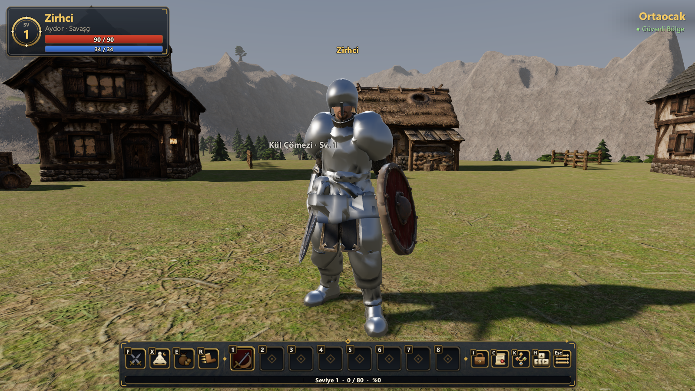
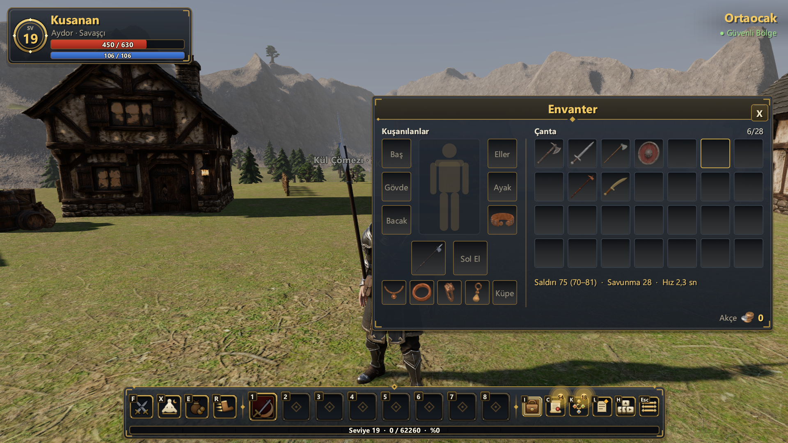

# Ortaocak

An old-school MMORPG written **without a game engine**: C++20 client and server, our own Direct3D 11
renderer, our own UI, an encrypted binary TCP protocol and PostgreSQL. Two nations, a shared market
village, grinding, loot, item upgrading, quests — the kind of game many of us grew up with, rebuilt
from scratch and in the open.

**Türkçe:** [README.tr.md](README.tr.md)

> **Status: in active development.** The game is playable end to end (log in, create a character,
> hunt, loot, trade, upgrade, quest, level to 20) but it is far from finished. We build it in the
> open and **we would love to build it together** — see [Contributing](#contributing).




## What is in the game today

- **Two races**, Aydor and Kargan, three classes each (warrior, rogue, mage), three looks per race.
- **Three zones**: Ortaocak with the neutral market village Eşik (zone 1), the Aydor homeland
  Tanyeri (zone 2) and the Kargan homeland Demirağız (zone 3), with gates between them.
- **Combat** decided by the server: basic attacks, 5-rank skills, attack power, defence, critical
  hits, dodge, weapon speed, reach and damage ranges.
- **Levels 1–20**, stat points (five attributes), skill points, a skill bar.
- **Items**: about 300 templates — weapons in several families and tiers, three armour lines that
  are drawn on the character, rings, earrings, necklaces, belts, potions, boss uniques.
- **Loot, shops and money** (Akçe), **item upgrading** (+0…+10) at the smith in Eşik.
- **Quests**: a starting chain in Eşik, homeland quests, repeatables, a quest log and trackers.
- **Other players**: you see each other move, fight, wear gear, sit, drink potions.
- **Coming next**: nation-versus-nation PvP in a contested zone, nation points and rankings,
  parties.

All names, texts, art and maps are original to this project. Mechanics follow the classic genre.

## Quick start

You need Windows 10/11 x64, Visual Studio 2022 or 2026 with the *Desktop development with C++*
workload, and Git. Nothing has to be on `PATH`.

```powershell
git clone https://github.com/vedatermis/ortaocak.git
cd ortaocak
powershell -ExecutionPolicy Bypass -File build.ps1                              # 1. build (first run 10-30 min: vcpkg)
powershell -ExecutionPolicy Bypass -File tools\dev\setup-dev.ps1                # 2. server keys + local configs (once)
powershell -ExecutionPolicy Bypass -File tools\build-assets.ps1 -Config Debug   # 3. compile assets_src -> assets
powershell -ExecutionPolicy Bypass -File tools\dev\run-dev.ps1                  # 4. start server + client
```

That is all: **no database is needed for a first run**. Without one the server keeps accounts and
characters in memory (they are gone when it stops). In the client, type any new user name (4–20
letters, digits or `_`) and a password of at least 6 characters; the development server creates the
account.

The repository is large (about 2 GB) because it carries every source asset and the screenshots of
every milestone. A shallow clone (`git clone --depth 1`) is enough to build and play.

Full details: [docs/BUILDING.md](docs/BUILDING.md).

### With a database (persistent characters)

1. Install PostgreSQL 15 or newer and create a role for the game.
2. Copy `config/server.local.toml.example` to `config/server.local.toml` (git-ignored) and put your
   own connection strings in it. **Never commit this file.**
3. Create the schema:

   ```powershell
   build\x64-debug\bin\vo_admin.exe migrate
   ```

   `vo_admin migrate` creates the database if it is missing and applies every script in
   [`db/migrations/`](db/migrations) in order. Those `.sql` files are the complete schema; you can
   also run them by hand with `psql` in file-name order.

The schema is documented in [docs/DATABASE.md](docs/DATABASE.md). No credentials of any real server
are in this repository, and none must ever be added.

## Where things are

| Path | What |
|---|---|
| `client/` | The game client: Direct3D 11 renderer, UI toolkit, scenes (login, character select, world), input, automation for scripted UI runs |
| `server/` | The game server: sessions, world simulation, combat, loot, shops, quests, persistence |
| `shared/` | Code used by both: protocol messages and opcodes, crypto, config, game rules and data parsing |
| `gamedata/` | Game content as TOML: items, monsters, skills, zones, shops, loot tables, quests |
| `db/migrations/` | SQL scripts that create and evolve the database schema |
| `config/` | Default client and server settings and the example for the local, git-ignored overrides |
| `assets_src/` | Source assets (glTF models, PNG textures, UI art, fonts) that the asset compiler turns into `assets/` |
| `tools/assetc/` etc. | The asset compiler and other build-time tools |
| `tools/blender/` | Headless Blender scripts that generate and process the art, with their source meshes |
| `tools/dev/` | Developer scripts: one-time setup, run the game, run the scripted UI flows |
| `tests/` | Unit tests, in-process server tests, bot client scenarios |
| `docs/` | Design and reference documents (see below) |
| `docs/screenshots/` | Screenshots taken by the scripted UI flows at every milestone |

Executables land in `build/<preset>/bin/`: `vo_client`, `vo_server`, `vo_admin` (database and
account administration), `vo_botclient` (headless test client), `vo_tests`, `assetc`.

## Documentation

| Document | Content |
|---|---|
| [docs/BUILDING.md](docs/BUILDING.md) | Requirements, building, running, tests, packaging, client command line |
| [docs/DEVELOPMENT_PLAN.md](docs/DEVELOPMENT_PLAN.md) | The full history of design decisions, milestone by milestone (Turkish) |
| [docs/PROTOCOL.md](docs/PROTOCOL.md) and `docs/PROTOCOL_*.md` | The network protocol: handshake, encryption, every message |
| [docs/SERVER_WORLD.md](docs/SERVER_WORLD.md) | Server architecture: world tick, areas of interest, persistence |
| [docs/CLIENT_RENDERING.md](docs/CLIENT_RENDERING.md) | The renderer: passes, materials, shadows, characters, terrain |
| [docs/DATABASE.md](docs/DATABASE.md) | Database schema, migrations, administration |
| [docs/ASSET_PIPELINE.md](docs/ASSET_PIPELINE.md), [docs/ASSET_FORMATS.md](docs/ASSET_FORMATS.md) | How art becomes runtime assets; the binary formats |
| [docs/CODING_STANDARDS.md](docs/CODING_STANDARDS.md) | Code style and conventions |
| [docs/LORE.md](docs/LORE.md) | The world and its peoples |
| [THIRD_PARTY.md](THIRD_PARTY.md) | Every library and every piece of content with its source and licence |

## Technology

- **Language and build**: C++20, MSVC, CMake + Ninja, vcpkg (all dependencies pinned and static).
- **Client**: Win32 + Direct3D 11, no engine and no UI library; fonts baked with stb_truetype.
- **Server**: Asio (IOCP), a fixed-tick authoritative world, PostgreSQL through libpqxx.
- **Network**: one TCP connection, X25519 key exchange with a pinned server key,
  XChaCha20-Poly1305 for every packet, Argon2id for passwords (libsodium).
- **Assets**: glTF in, our own compact formats out (`assetc`); BC-compressed textures.
- **Tests**: Catch2 unit tests, in-process server tests, a bot client that plays whole scenarios,
  and scripted UI flows that drive the real client and take screenshots.

## Running the tests

```powershell
powershell -File build.ps1 -Test              # unit + integration tests (about 45 min in Debug)
powershell -File tools\dev\run-ui-flows.ps1   # scripted runs of the real client (about an hour)
```

The PostgreSQL-backed tests run only when `db.test_connection_string` (or `VEDAT_TEST_DB_URL`) names
a database called `vedatonline_test`; otherwise they skip themselves.

## Contributing

Contributions are welcome: code, content, art, balance ideas, bug reports, translations. Please read
[CONTRIBUTING.md](CONTRIBUTING.md) first. In short:

- Open an issue to discuss anything bigger than a small fix.
- Work on a branch in your fork and open a pull request against `main`.
- **Every pull request is reviewed by a maintainer before it is merged; nothing goes into `main`
  directly.**
- Everything you add must be original or under a licence that allows it here. Do not copy names,
  art, maps or data from other games.

## Licence

See [LICENSE](LICENSE) for the code and [THIRD_PARTY.md](THIRD_PARTY.md) for the libraries and for
the origin and terms of every asset. Part of the art was generated with third-party services whose
terms apply to it; read that file before using the art outside this project.
