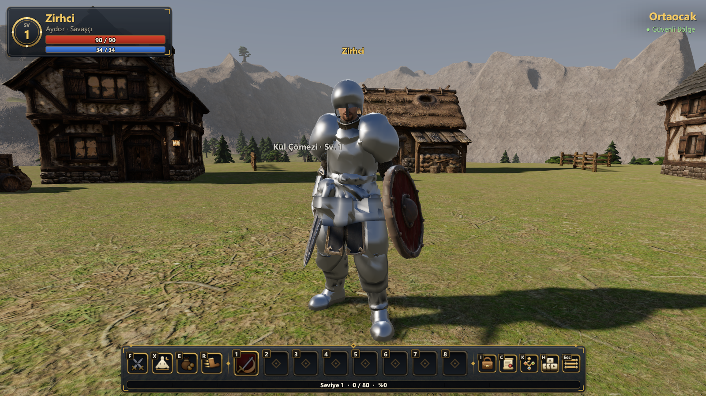
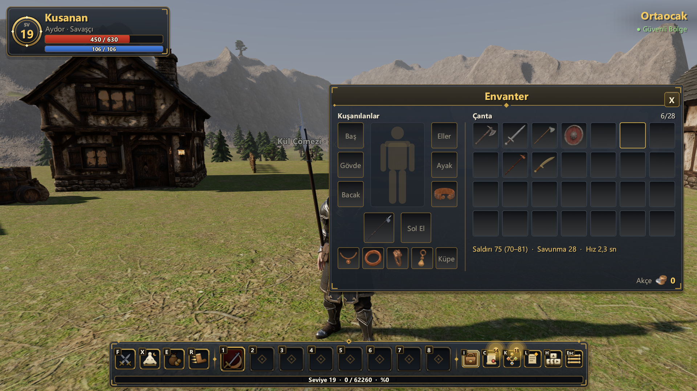

# Ortaocak

**Oyun motoru kullanmadan** yazılmış eski usul bir MMORPG: C++20 istemci ve sunucu, kendi
Direct3D 11 çizim katmanımız, kendi arayüzümüz, şifreli ikili TCP protokolü ve PostgreSQL. İki ulus,
ortak bir pazar köyü, kasılma, ganimet, eşya yükseltme, görevler — çoğumuzun büyürken oynadığı türden
bir oyun; sıfırdan ve açıkta yeniden yapılıyor.

**English:** [README.md](README.md)

> **Durum: geliştirme sürüyor.** Oyun baştan sona oynanabiliyor (giriş, karakter oluşturma, av,
> ganimet, alışveriş, yükseltme, görev, 20. seviyeye kadar) ama bitmiş değil. Açıkta geliştiriyoruz
> ve **birlikte yapmak istiyoruz** — [Katkı](#katkı) bölümüne bakın.




## Oyunda bugün neler var

- **İki ırk**, Aydor ve Kargan; her birinde üç sınıf (savaşçı, hırsız, büyücü) ve üç görünüş.
- **Üç bölge**: tarafsız pazar köyü Eşik'in bulunduğu Ortaocak (bölge 1), Aydor yurdu Tanyeri
  (bölge 2) ve Kargan yurdu Demirağız (bölge 3); aralarında geçitler.
- **Dövüş** sunucuda hesaplanır: düz vuruş, 5 kademeli yetenekler, saldırı gücü, savunma, kritik,
  kaçınma, silah hızı, erim ve hasar aralığı.
- **Seviye 1–20**, stat puanları (beş nitelik), yetenek puanları, yetenek çubuğu.
- **Eşyalar**: yaklaşık 300 şablon — çeşitli ailelerde ve kademelerde silahlar, karakterin üstünde
  görünen üç zırh hattı, yüzük, küpe, kolye, kemer, iksirler, boss eşyaları.
- **Ganimet, dükkânlar ve para** (Akçe), Eşik'teki demircide **eşya yükseltme** (+0…+10).
- **Görevler**: Eşik'te başlangıç zinciri, yurt görevleri, tekrarlanabilir görevler, görev günlüğü.
- **Diğer oyuncular**: birbirinizin yürüdüğünü, dövüştüğünü, giydiğini, oturduğunu görürsünüz.
- **Sırada**: çekişmeli bölgede ulus savaşı, ulus puanı ve sıralama, parti sistemi.

Bütün adlar, metinler, görseller ve haritalar bu projeye özgüdür. Mekanikler klasik türü izler.

## Hızlı başlangıç

Gerekenler: Windows 10/11 x64, *C++ ile masaüstü geliştirme* iş yükü kurulu Visual Studio 2022 veya
2026, ve Git. `PATH`'e bir şey eklemeniz gerekmez.

```powershell
git clone <bu depo>
cd ortaocak
powershell -ExecutionPolicy Bypass -File build.ps1                              # 1. derle (ilk sefer 10-30 dk: vcpkg)
powershell -ExecutionPolicy Bypass -File tools\dev\setup-dev.ps1                # 2. sunucu anahtarları + yerel ayarlar (bir kez)
powershell -ExecutionPolicy Bypass -File tools\build-assets.ps1 -Config Debug   # 3. assets_src -> assets
powershell -ExecutionPolicy Bypass -File tools\dev\run-dev.ps1                  # 4. sunucu + istemci
```

Bu kadar: **ilk çalıştırma için veritabanı gerekmez**. Veritabanı yoksa sunucu hesapları ve
karakterleri bellekte tutar (sunucu kapanınca silinir). İstemcide yeni bir kullanıcı adı (4–20 harf,
rakam veya `_`) ve en az 6 karakterlik bir şifre yazın; geliştirme sunucusu hesabı kendisi açar.

Depo büyüktür (yaklaşık 2 GB), çünkü bütün kaynak asset'leri ve her aşamanın ekran görüntülerini
taşır. Derleyip oynamak için sığ klon (`git clone --depth 1`) yeterlidir.

Ayrıntılar: [docs/BUILDING.md](docs/BUILDING.md).

### Veritabanıyla (kalıcı karakterler)

1. PostgreSQL 15 veya üstünü kurun ve oyun için bir rol oluşturun.
2. `config/server.local.toml.example` dosyasını `config/server.local.toml` adıyla kopyalayın
   (git bunu yok sayar) ve kendi bağlantı bilgilerinizi yazın. **Bu dosyayı asla commit etmeyin.**
3. Şemayı oluşturun:

   ```powershell
   build\x64-debug\bin\vo_admin.exe migrate
   ```

   `vo_admin migrate` veritabanı yoksa oluşturur ve [`db/migrations/`](db/migrations) içindeki bütün
   betikleri sırayla uygular. Bu `.sql` dosyaları şemanın tamamıdır; isterseniz `psql` ile dosya adı
   sırasına göre elle de çalıştırabilirsiniz.

Şema [docs/DATABASE.md](docs/DATABASE.md) içinde anlatılır. Bu depoda hiçbir gerçek sunucunun
bağlantı bilgisi yoktur ve asla eklenmemelidir.

## Nerede ne var

| Yol | İçerik |
|---|---|
| `client/` | Oyun istemcisi: Direct3D 11 çizim katmanı, arayüz, sahneler (giriş, karakter seçimi, dünya), girdi, betikli arayüz koşuları |
| `server/` | Oyun sunucusu: oturumlar, dünya benzetimi, dövüş, ganimet, dükkânlar, görevler, kalıcılık |
| `shared/` | İkisinin ortak kodu: protokol mesajları, şifreleme, ayarlar, oyun kuralları ve veri okuma |
| `gamedata/` | TOML olarak oyun içeriği: eşyalar, canavarlar, yetenekler, bölgeler, dükkânlar, ganimet, görevler |
| `db/migrations/` | Veritabanı şemasını oluşturan ve geliştiren SQL betikleri |
| `config/` | Varsayılan istemci ve sunucu ayarları, yerel ayar dosyası örneği |
| `assets_src/` | Kaynak asset'ler (glTF modeller, PNG dokular, arayüz görselleri, yazı tipleri) |
| `tools/` | Asset derleyicisi ve diğer araçlar |
| `tools/blender/` | Görselleri üreten ve işleyen başsız Blender betikleri ve kaynak modeller |
| `tools/dev/` | Geliştirici betikleri: kurulum, oyunu çalıştırma, betikli arayüz akışları |
| `tests/` | Birim testleri, süreç içi sunucu testleri, bot istemci senaryoları |
| `docs/` | Tasarım ve başvuru belgeleri |
| `docs/screenshots/` | Her aşamada betikli akışların aldığı ekran görüntüleri |

Çalıştırılabilir dosyalar `build/<preset>/bin/` altına çıkar: `vo_client`, `vo_server`, `vo_admin`
(veritabanı ve hesap yönetimi), `vo_botclient` (başsız test istemcisi), `vo_tests`, `assetc`.

## Belgeler

| Belge | İçerik |
|---|---|
| [docs/BUILDING.md](docs/BUILDING.md) | Gereksinimler, derleme, çalıştırma, testler, paketleme |
| [docs/DEVELOPMENT_PLAN.md](docs/DEVELOPMENT_PLAN.md) | Aşama aşama bütün tasarım kararları (Türkçe) |
| [docs/PROTOCOL.md](docs/PROTOCOL.md) ve `docs/PROTOCOL_*.md` | Ağ protokolü: el sıkışma, şifreleme, bütün mesajlar |
| [docs/SERVER_WORLD.md](docs/SERVER_WORLD.md) | Sunucu mimarisi |
| [docs/CLIENT_RENDERING.md](docs/CLIENT_RENDERING.md) | Çizim katmanı |
| [docs/DATABASE.md](docs/DATABASE.md) | Veritabanı şeması, göçler, yönetim |
| [docs/ASSET_PIPELINE.md](docs/ASSET_PIPELINE.md), [docs/ASSET_FORMATS.md](docs/ASSET_FORMATS.md) | Asset üretim hattı ve dosya biçimleri |
| [docs/CODING_STANDARDS.md](docs/CODING_STANDARDS.md) | Kod yazım kuralları |
| [docs/LORE.md](docs/LORE.md) | Dünya ve halkları |
| [THIRD_PARTY.md](THIRD_PARTY.md) | Bütün kütüphaneler ve içerikler; kaynakları ve lisansları |

## Testler

```powershell
powershell -File build.ps1 -Test              # birim + bütünleşme testleri (Debug'da yaklaşık 45 dk)
powershell -File tools\dev\run-ui-flows.ps1   # gerçek istemcinin betikli koşuları (yaklaşık bir saat)
```

PostgreSQL testleri yalnızca `db.test_connection_string` (veya `VEDAT_TEST_DB_URL`) adı
`vedatonline_test` olan bir veritabanını gösteriyorsa koşar; yoksa kendilerini atlarlar.

## Katkı

Her türlü katkıya açığız: kod, içerik, görsel, denge önerisi, hata bildirimi, çeviri. Önce
[CONTRIBUTING.md](CONTRIBUTING.md) dosyasını okuyun. Kısaca:

- Küçük bir düzeltmeden büyük her şey için önce bir issue açıp konuşalım.
- Kendi fork'unuzda bir dalda çalışın ve `main` dalına pull request açın.
- **Her pull request birleştirilmeden önce bir bakımcı tarafından incelenir; `main` dalına doğrudan
  hiçbir şey girmez.**
- Eklediğiniz her şey özgün olmalı ya da burada kullanılmasına izin veren bir lisans taşımalı. Başka
  oyunlardan ad, görsel, harita veya veri kopyalamayın.

## Lisans

Kod için [LICENSE](LICENSE), kütüphaneler ile her asset'in kaynağı ve koşulları için
[THIRD_PARTY.md](THIRD_PARTY.md) dosyasına bakın. Görsellerin bir kısmı üçüncü taraf hizmetlerle
üretildi ve o hizmetlerin koşullarına tabidir; görselleri bu proje dışında kullanmadan önce o dosyayı
okuyun.
